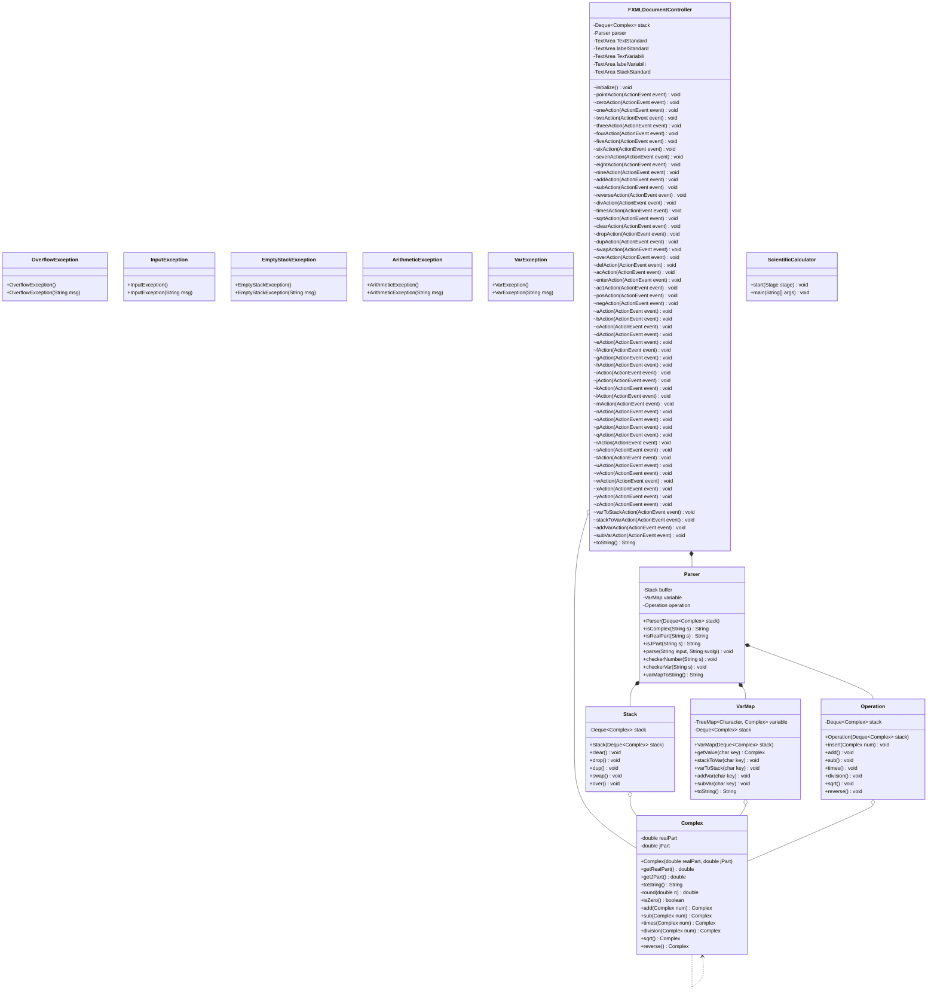

# 🧮 Programmable Complex Calculator

> A scientific programmable calculator supporting complex numbers, stack operations, and variables, developed as a university project for the **Software Engineering** course (Academic Year 2023/2024) at the University of Salerno (Unisa).

---

## 👥 Collaborators
- **Anzivino Giuseppe Fabrizio** — [@GiuseppeAnzivino](https://github.com/GiuseppeAnzivino)
- **Borrelli Simone** — [@simoneborrelli07](https://github.com/simoneborrelli07)
- **Buongiorno Aldo** — [@AldoBuongiorno](https://github.com/AldoBuongiorno)
- **Calabrese Raffaele** — [@RaffaeleCalabrese2](https://github.com/RaffaeleCalabrese2)

---

## 📋 Table of Contents
- [About the Project](#about)
- [Versions & How to Run](#versions)
- [Project Planning & Methodology](#planning)
- [Project Documentation (`/docs`)](#docs)
- [Architecture & Design Patterns](#architecture)
- [Tech Stack & Implementation](#tech-stack)
- [Testing & Quality Assurance](#testing)
- [Key Features & Requirements](#features)
- [Video Demo](#demo)
- [Modern Class Diagram Generation](#UMLGeneration)
- [LIcense](#license)

---

<a id="about"></a>
## 🚀 About the Project
This project implements a fully functional scientific calculator designed around a **stack-based architecture** and following a rigorous **waterfall development model**. It handles complex numbers (with real and imaginary parts in Cartesian notation) and executes operations sequentially by pulling operands from the stack and pushing results back. 

The software engineering lifecycle encompassed complete project planning, WBS (Work Breakdown Structure) creation, Gantt scheduling, requirements elicitation, detailed UML design, unit/functional testing, and clean Java implementation.

---

<a id="versions"></a>
## 📦 Versions & How to Run
The project is available in three versions, each in its own folder with a dedicated README:

| Folder | Description | Best for |
|---|---|---|
| [`JAR_Version/`](JAR_Version/) | Ready-to-run executable JAR with launchers for Windows, macOS and Linux | Just **using** the calculator, no build needed |
| [`v1_Netbeans/`](v1_Netbeans/) | Original project developed with Apache NetBeans | Historical reference, opening the project in NetBeans |
| [`v2_VSCode/`](v2_VSCode/) | Maven project configured for Visual Studio Code, with the `javafx-maven-plugin` (`mvn javafx:run`) | Building, running and developing on **Linux** |

The application source code is the same in all versions: only the way the project is packaged, configured and launched changes. The second version was created because the NetBeans one ran into JavaFX / JDK / OS incompatibilities on Linux.

> **Note:** all versions require a **JDK 8 with JavaFX** (e.g. Zulu JDK FX 8 or Liberica Full JDK 8). See the README of each folder for details.

**Quick start (no build):**
```bash
cd JAR_Version
java -jar ScientificCalculator.jar
```

---

<a id="planning"></a>
## 📊 Project Planning & Methodology
- **Development Model:** Waterfall model (structured macro-phases: Planning, Requirements Engineering, System Design, Implementation, and Testing).
- **Scheduling & Tracking:** Managed via Gantt charts and Work Breakdown Structures (WBS) (using GanttPRO and dedicated tracking documents) to ensure strict adherence to milestones.
- **Traceability:** Maintained through a comprehensive Traceability Matrix linking requirements, design artifacts, and test cases across the lifecycle.

---

<a id="docs"></a>
## 📂 Project Documentation (`/docs`)
The complete software engineering documentation is organized chronologically following the waterfall lifecycle and is stored inside the `docs/` directory:

1. **[01_Software_Project_Planning.pdf](docs/01_Software_Project_Planning.pdf)**: Project organization, WBS, Gantt scheduling, and resource allocation.
2. **[02_Software_Project_Requisiti.pdf](docs/02_Software_Project_Requisiti.pdf)**: Requirements elicitation, use cases, and functional specifications.
3. **[03_Software_Project_Design.pdf](docs/03_Software_Project_Design.pdf)**: System architecture (Shared Repository), UML class/sequence diagrams, activity/state diagrams, and code metrics (LCOM and Coupling).
4. **[04_Software_Project_Implementation.pdf](docs/04_Software_Project_Implementation.pdf)**: Implementation details, UI design with JavaFX Scene Builder, and traceability matrix updates.
5. **[05_Software_Project_Testing.pdf](docs/05_Software_Project_Testing.pdf)**: Comprehensive test planning, functional end-to-end test cases (FTC), and automated JUnit unit test suites (UTC) for the core model.

---

<a id="architecture"></a>
## 🏗️ Architecture & Design Patterns
- **Shared Repository Architecture:** The system relies on a centralized persistent component layout to facilitate data sharing across modules.
- **UML Modeling:** Extensive design phase incorporating **Class Diagrams**, **Sequence Diagrams** (for operands insertion, operations, stack manipulation, and variable management), **Activity Diagrams**, and **State Machine Diagrams**.
- **Code Metrics:** Analyzed via LCOM (Lack of Cohesion of Methods) and Coupling metrics to evaluate system modularity and dependencies stemming from shared data structures.

---

<a id="tech-stack"></a>
## 🛠️ Tech Stack & Implementation
- **Language & Build Tool:** Java, managed via **Maven** (`pom.xml`) for dependency handling and project building.
- **IDE:** Apache NetBeans (`v1_Netbeans`) and Visual Studio Code (`v2_VSCode`)
- **UI Framework:** JavaFX, designed using **JavaFX Scene Builder 2.0** (supporting dual interfaces: Standard Calculator and Variables View).
- **Core Components:**
  - `FXMLDocumentController`: Manages UI interactions and event handling.
  - `Parser`: Handles string-to-complex conversions, syntax validation, and command routing.
  - `Stack`: Manages stack data structures (Deque) and manipulation commands.
  - `Operation`: Implements arithmetic and algebraic logic.
  - `VarMap`: Manages the 26 variable memory registers (`a` to `z`).
  - Custom Exception classes (`EmptyStackException`, `FullStackException`, `ArithmeticException`, `OverflowException`, `InputException`, `VarException`).

---

<a id="testing"></a>
## 🧪 Testing & Quality Assurance
- **Test Planning:** Comprehensive verification focusing heavily on the core computational model and data structures, complemented by manual GUI and functional interaction testing.
- **Functional Test Cases (FTC):** End-to-end scenarios validating arithmetic flows (`FTC-01`), stack manipulations (`FTC-02`), and variable memory operations (`FTC-03`) along with proper error handling (e.g., division by zero, empty stack).
- **Automated Unit Tests (JUnit):** Exhaustive test suites covering all core classes with 100% passing results:
  - `ComplexTest`: Validates real/imaginary getters, string formatting, zero checks, basic arithmetic (+, -, *, /), square roots (`sqrt`), and sign inversion (`reverse`).
  - `OperationTest`: Verifies correct execution of operations directly through the stack layer and proper exception throwing.
  - `ParserTest`: Tests string tokenization, number checks (`isComplex`, `isRealPart`, `isJPart`), parsing logic, and syntax exception handling.
  - `StackTest`: Ensures stack behavior under `clear`, `drop`, `dup`, `swap`, and `over` commands including edge cases on empty stacks.
  - `VarMapTest`: Tests variable storage, stack-to-variable (`>var`) and variable-to-stack (`<var`) transfers, arithmetic variable updates (`+var`, `-var`), and mapping string outputs.

---

<a id="features"></a>
## ✨ Key Features & Requirements

### 1. Complex Numbers & Basic Operations
- Support for complex numbers in Cartesian notation (e.g., `7.2+4.9j`, treating pure real numbers as numbers with a zero imaginary part).
- Core arithmetic operations: 
  - `+` (Addition), `-` (Subtraction), `*` (Multiplication), `/` (Division)
  - `sqrt` (Square root), `+-` (Invert sign)

### 2. Stack Manipulation Commands
- Stack visualization displaying at least the top **12 elements**.
- `clear`: Removes all elements from the stack.
- `drop`: Removes the top element.
- `dup`: Duplicates the top element.
- `swap`: Exchanges the last two elements.
- `over`: Pushes a copy of the second-to-last element.

### 3. Variables Memory (26 Registers)
- Supports 26 variables named from `a` to `z` with a dedicated variables interface screen.
- Operations:
  - `>x`: Pops the top stack value and saves it into variable `x`.
  - `<x`: Pushes the value of variable `x` onto the stack.
  - `+x`: Adds the top stack value to variable `x`.
  - `-x`: Subtracts the top stack value to variable `x`.

---

<a id="demo"></a>
## 📺 Video Demo

Watch a practical demonstration of the calculator and graphical user interface:

[](https://youtu.be/FplfppbxDv4)

*(If you prefer to download or view the raw file directly, you can find it in the [`assets/demo.mp4`](assets/demo.mp4) folder).*

---
<a id="UMLGeneration"></a>
## 🎨 Modern Class Diagram Generation
To provide an accurate and up-to-date visual representation of the current codebase without manual transcription errors, the class diagram was reverse-engineered directly from the Java source files (`v1_Netbeans/src/main/java/Calcolatrice`) using the **UML Generator for Java** extension in VS Code.

The structure extracted has been mapped to the **Mermaid** diagram below for native rendering on GitHub:



---
<a id="license"></a>
## 📄 License
All rights reserved. This repository is published for viewing and educational reference only. See [`LICENSE`](LICENSE) for details.